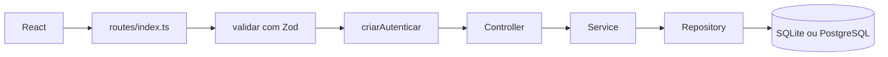

# Arquitetura — Navalha

Este documento justifica a stack, mostra a estrutura de pastas e localiza no código cada padrão pedido no trabalho: MVC, Repository, Service, validação na borda e componentes reutilizáveis.

## 1. Por que estas linguagens e tecnologias

| Escolha | Por quê |
|---------|---------|
| TypeScript no front e no back | O mesmo vocabulário de tipos (cliente, serviço, agendamento, papel) atravessa a API e a tela. O compilador pega campo renomeado e retorno esquecido antes da demo. Atende o RNF05. |
| React + Vite | A interface é uma SPA com poucas telas e vários formulários parecidos. Vite sobe rápido e o proxy de desenvolvimento encaminha `/api` para a API, então o navegador fala com uma origem só. |
| Node.js + Express | A API é CRUD com poucas regras. Express deixa a rota, o middleware de validação e o middleware de autenticação explícitos, na ordem em que a requisição passa. É um encaixe direto com o MVC pedido. |
| Zod na borda | O corpo JSON chega sem tipo. Zod descreve o contrato (uuid, e-mail, duração inteira, preço com duas casas) e devolve 400 antes de qualquer regra de negócio. |
| bcrypt (`bcryptjs`) | Hash de senha com sal, sem módulo nativo para compilar. O custo está em `BCRYPT_COST` (10 na demo, 4 nos testes). |
| JWT | A API não guarda sessão em tabela. O token carrega o sujeito, o papel e um `jti`. O logout coloca o `jti` numa lista em memória até o `exp`. É o bastante para um processo só; um cluster precisaria de armazenamento compartilhado. |
| SQLite via `node:sqlite` | Um arquivo só, sem servidor de banco, suficiente para a banca clonar e rodar. O módulo entra no Node 22 e dispensa compilação de `better-sqlite3`. O aviso “experimental” do Node é esperado. |
| PostgreSQL opcional (`pg`) | O mesmo schema SQL (texto, inteiro 0/1, checks) roda nos dois. O adaptador troca `?` por `$1`. O Compose sobe o Postgres só com o perfil `postgres`, para não obrigar quem quer a demo com SQLite. |
| Vitest + Supertest | Vitest executa os services contra SQLite em memória. Supertest dispara a mesma função `criarAplicacao` sem abrir porta, então o teste de API cobre status HTTP, Zod e papéis. |
| Docker Compose | Reproduz API + interface (e, se pedido, o Postgres) sem instalar Node na máquina da banca. O caminho padrão continua sendo `npm run dev`, descrito no README. |

Não entrou ESLint. A checagem estática obrigatória é `tsc` estrito nos dois pacotes, chamada pelo `npm run build`.

## 2. Estrutura de pastas

```text
.
├── backend/
│   ├── src/
│   │   ├── index.ts              # sobe HTTP, migra e semeia
│   │   ├── app.ts                # Express: CORS, JSON, rotas, erro
│   │   ├── composition.ts        # liga repositório → service
│   │   ├── config.ts
│   │   ├── auth/                 # JWT e revogação
│   │   ├── domain/               # tipos, conflito de horário, fuso, texto
│   │   ├── db/                   # SQLite, Postgres, migração, seed
│   │   ├── schemas/              # contratos Zod
│   │   ├── middlewares/
│   │   ├── routes/index.ts
│   │   ├── controllers/
│   │   ├── services/
│   │   └── repositories/
│   └── tests/
│       ├── unit/                 # services e regras puras
│       └── api/                  # Supertest
├── frontend/
│   └── src/
│       ├── api/                  # cliente HTTP
│       ├── auth/                 # sessão no navegador
│       ├── components/ui/        # botão, campos, tabela, modal
│       ├── components/layout/    # casca autenticada
│       ├── pages/
│       └── utils/format.ts
├── docs/
├── docker-compose.yml
└── docker-compose.postgres.yml
```

## 3. Fluxo de uma requisição



Exemplo concreto, criar agendamento:

1. `POST /api/agendamentos` em `backend/src/routes/index.ts` passa por `criarAutenticar` e `validar(criarAgendamentoSchema)`.
2. `AgendamentoController.criar` só lê o DTO já validado e o usuário do token.
3. `AgendamentoService.criar` exige cliente ativo, serviço ativo, atendente ativo, horário futuro e ausência de conflito. Calcula o fim com `somarMinutos`.
4. `AgendamentoRepository` grava e lê de volta com os nomes de cliente, serviço e atendente.
5. A tela `frontend/src/pages/AgendaPage.tsx` mostra o 409 quando o service recusa o horário.

## 4. MVC

| Camada | Responsabilidade | Onde |
|--------|------------------|------|
| Model | Tipos de domínio e SQL nas tabelas | `backend/src/domain/tipos.ts`, `backend/src/db/migrar.ts` |
| View | SPA. A API não renderiza HTML | `frontend/src/pages/*` |
| Controller | Traduz HTTP em chamada de service e status | `backend/src/controllers/*.controller.ts` |

O controller não calcula conflito nem hash de senha. `AuthController.login` chama `AuthService.entrar` e devolve 200. `AgendamentoController` escolhe 201 na criação e repassa o corpo. Status de negócio (401, 403, 404, 409, 422) nascem como `AppError` no service e são serializados em `backend/src/middlewares/error-handler.ts` no formato `{ erro, detalhes? }`.

As rotas ficam num único mapa, `backend/src/routes/index.ts`, para a ordem dos middlewares ficar visível: saúde, login e cadastro público são abertos; o restante exige token; usuários e escrita de serviços exigem `somenteAdmin`. O cadastro público chama `UsuarioService.cadastrarPublico`, que fixa o papel em atendente antes de gravar o hash.

## 5. Service

A regra de negócio mora em `backend/src/services/`.

- `AuthService` confere senha e recusa usuário inativo.
- `UsuarioService` impede inativar a si mesmo e apagar o último administrador ativo.
- `ClienteService` normaliza telefone para dígitos e recusa duplicata de telefone ou e-mail.
- `ServicoService` guarda preço em reais na borda e só exclui serviço sem agendamento.
- `AgendamentoService` é o único lugar que decide conflito, passado, papel do atendente e transição de status.

Os testes em `backend/tests/unit/*.service.test.ts` instanciam esses services com SQLite em memória, sem HTTP. A regra pura de intervalo está em `backend/src/domain/horario.ts` (`intervalosConflitam`) e é reutilizada pelo repositório ao varrer a agenda do atendente.

## 6. Repository

Cada agregado tem uma classe em `backend/src/repositories/`:

- `UsuarioRepository`
- `ClienteRepository`
- `ServicoRepository`
- `AgendamentoRepository`

Eles conhecem SQL e o formato da linha (`senha_hash`, `preco_centavos`, `ativo` 0/1). Devolvem objetos do domínio em camelCase. Não conhecem JWT nem Zod.

O acesso ao banco passa por `DbClient` (`backend/src/db/cliente-banco.ts`), com duas implementações:

- `SqliteBanco` em `backend/src/db/sqlite.ts`
- `PostgresBanco` em `backend/src/db/postgres.ts`

`BancoComFila` serializa o uso de uma única conexão. `transaction()` abre `BEGIN` e, via `AsyncLocalStorage`, faz os repositórios chamados dentro do callback participarem do mesmo commit. O service escreve `return this.banco.transaction(async () => { ... })` sem receber uma conexão extra. Isso cobre o caso de dois agendamentos simultâneos no mesmo processo: a checagem de conflito e o `INSERT` não se intercalam com outra requisição.

Uma conexão única é adequada ao porte do trabalho. Um pool por requisição seria o passo seguinte se a API atendesse muita gente ao mesmo tempo.

## 7. Validação na borda

O middleware `validar` está em `backend/src/middlewares/validar.ts`. Ele aplica um schema Zod em `{ body, query, params }` e, se falhar, chama `next` com `AppError` 400 e a lista `{ caminho, mensagem }`. O controller só lê `req.dados` depois disso.

Os schemas ficam em `backend/src/schemas/`. Cada rota de escrita em `backend/src/routes/index.ts` declara o schema antes do método do controller. Exemplos:

- `loginSchema` exige e-mail e senha
- `criarClienteSchema` exige telefone com 10 ou 11 dígitos
- `criarServicoSchema` exige duração inteira positiva e preço com no máximo duas casas
- `criarAgendamentoSchema` exige UUIDs e um instante ISO com fuso

Regra de negócio que depende do banco (duplicata, conflito, papel) não fica no Zod. Fica no service, com 409 ou 422.

## 8. Componentes reutilizáveis no front

As telas não desenham `<button>` e `<table>` soltos. Elas compõem peças de `frontend/src/components`:

| Componente | Arquivo | Usado em |
|------------|---------|----------|
| `Button` | `components/ui/Button.tsx` | todas as páginas e o menu Sair |
| `TextField`, `SelectField`, `TextAreaField`, `Field` | `components/ui/FormFields.tsx` | login, modais de cliente, serviço, usuário e agenda |
| `DataTable` | `components/ui/DataTable.tsx` | início, clientes, serviços, usuários, agenda |
| `Modal` | `components/ui/Modal.tsx` | formulários de cadastro e remarcação |
| `PageHeader`, `Badge`, `Alert` | `components/ui/Chrome.tsx` | título da página, status e erros da API |
| `AppLayout` | `components/layout/AppLayout.tsx` | menu, marca e área logada |
| `ProtectedRoute` | `components/layout/ProtectedRoute.tsx` | bloqueia rota sem sessão |

`DataTable` recebe colunas com `render`, então a mesma tabela mostra moeda, badge ou botões. `Field` gera o `id` do input e associa o `<label>`. O cliente HTTP único está em `frontend/src/api/client.ts`: coloca o Bearer, interpreta `{ erro, detalhes }` e, em 401, limpa o token.

A sessão de tela está em `frontend/src/auth/AuthContext.tsx`. O token fica em `localStorage` (`navalha.token`). Para este trabalho isso simplifica a demo; um cookie `HttpOnly` seria o endurecimento seguinte.

## 9. Autenticação e papéis

- `backend/src/utils/senha.ts` gera e confere o hash.
- `backend/src/auth/token.ts` assina e verifica o JWT (`sub`, `nome`, `email`, `papel`, `jti`, `exp`).
- `backend/src/auth/revogacao.ts` guarda `jti` revogados até expirarem.
- `backend/src/middlewares/auth.ts`: `criarAutenticar` exige Bearer, recusa token revogado ou usuário inativo e preenche `req.usuario`. `somenteAdmin` responde 403 para atendente.

O atendente não vê o item Usuários no menu (`AppLayout`). A API recusa a rota mesmo se a URL for chamada direto. Na agenda, o atendente não escolhe outro profissional: o service compara `usuarioId` com o id do token.

## 10. Banco e seed

`migrar` em `backend/src/db/migrar.ts` cria as quatro tabelas com `CREATE TABLE IF NOT EXISTS`. O schema evita tipos que só existem num dos bancos: boolean é inteiro 0/1, data é texto ISO-8601, preço é inteiro em centavos.

`semearSeVazio` em `backend/src/db/seed.ts` roda na subida quando `SEED` não é `false` e ainda não há usuários. Cria a equipe de demonstração, cinco clientes, cinco serviços (um inativo) e a agenda de exemplo. Agendamentos do seed são inseridos pelo repositório, então um horário da manhã continua visível mesmo que a demo seja à tarde. Criar pela API continua sujeito à regra de “não agendar no passado”.

Contas:

- `admin@barbearia.local` / `admin123` (Helena Prado)
- `atendente@barbearia.local` / `atendente123` (Caio Nunes)

## 11. Limitações conscientes

- A lista de tokens revogados mora no processo. Reiniciar a API esquece os logouts.
- Não há paginação. O volume de uma barbearia cabe numa lista.
- Não houve ensaio medindo o RNF04 (500 ms). A suíte automática inteira termina em poucos segundos, o que não substitui um benchmark.
- `node:sqlite` ainda é marcado como experimental pelo Node.
- A busca de clientes filtra em memória depois do `SELECT`, com `toLocaleLowerCase('pt-BR')`. O catálogo esperado é pequeno.
- O Docker Compose está no repositório. A execução que produziu o laudo usou Node local porque o ambiente não tinha daemon Docker.
