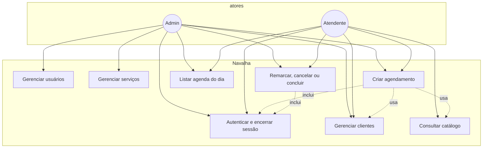
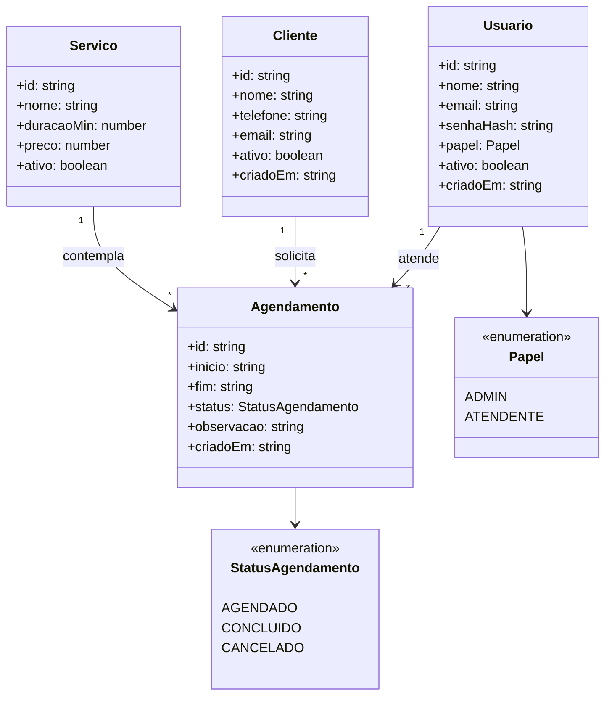

# Planejamento — Navalha

**Projeto:** Projeto Integrador Transdisciplinar em Engenharia de Software II  
**Produto:** Navalha — sistema web de agendamento para barbearia  
**Prazo de entrega:** 05/11/2026  
**Stack:** React + Vite + TypeScript (front) · Node.js + Express + TypeScript (back, MVC + Repository + Service, validação Zod na borda) · SQLite por padrão (`node:sqlite`) · PostgreSQL opcional via Docker Compose · Vitest + Supertest

---

## 1. Visão do produto

Aplicação web para uma barbearia gerenciar clientes, o catálogo de serviços e a agenda de horários, com autenticação de usuários internos (administrador e atendente).

**Problema:** o controle da agenda em papel ou WhatsApp gera conflitos de horário, perda de histórico e dificuldade de acompanhar a demanda do dia.

**Público:** dono/administrador e atendentes da barbearia. O cliente final não acessa o sistema nesta versão.

**Escopo (in):**

- Login com senha armazenada em hash (bcrypt) e sessão por JWT
- Logout que invalida o token enquanto o processo da API está no ar
- CRUD de Usuario, Cliente, Servico e Agendamento
- Regras: horário livre para o mesmo atendente (considerando a duração), serviço ativo, cliente ativo, data no passado rejeitada
- Papéis: administrador gerencia usuários e o catálogo; atendente opera clientes e a própria agenda
- Persistência padrão em SQLite e opção de PostgreSQL no Docker Compose
- Testes automatizados dos services e da API

**Fora de escopo (out):**

- App mobile nativo
- Portal do cliente / autoagendamento público
- Pagamentos, fidelidade e estoque
- Notificações por SMS, e-mail ou WhatsApp
- Várias barbearias (multi-tenant)
- Relatórios avançados e BI
- Benchmark formal de latência (o alvo local está no RNF04, sem medição dedicada nesta entrega)

**Decisões de negócio fechadas na implementação:**

- O fim do agendamento é `início + duração do serviço`. Horários que apenas se encostam (um termina quando o outro começa) são aceitos.
- Conflito é por atendente. Dois atendentes podem ocupar o mesmo instante.
- Status `CANCELADO` libera o horário. `CONCLUIDO` continua ocupando o intervalo.
- Não se cria nem se remarca com início anterior ao momento atual (tolerância de 1 minuto).
- Datas exibidas e filtradas por dia usam o fuso `America/Sao_Paulo`.
- O atendente só cria, remarca, cancela ou conclui horários da própria agenda. O administrador pode escolher o atendente na criação.
- Excluir serviço é definitivo e só vale se ele nunca foi usado. Caso contrário, a operação correta é inativar.
- Inativar cliente, serviço ou usuário com agendamento futuro em aberto é recusado até o cancelamento desses horários.
- Não é possível inativar o próprio usuário nem remover o último administrador ativo.
- O cadastro aberto na tela de login grava sempre o papel atendente. Pedido de administrador nesse corpo é ignorado. Administrador continua nascendo só pela rota autenticada de usuários.

---

## 2. Requisitos funcionais

| ID | Requisito | Onde aparece |
|----|-----------|----------------|
| RF01 | Autenticar por e-mail e senha e emitir JWT | `POST /api/auth/login` |
| RF02 | Encerrar sessão | `POST /api/auth/logout` revoga o `jti` do token |
| RF03 | Cadastrar, listar, editar e inativar Usuario (admin) | `/api/usuarios` |
| RF04 | Cadastrar, listar, editar e inativar Cliente, com busca | `/api/clientes` |
| RF05 | Cadastrar, listar, editar, ativar/inativar e excluir Servico (nome, duração, preço) | `/api/servicos` |
| RF06 | Criar Agendamento ligando cliente, serviço, atendente e data/hora | `POST /api/agendamentos` |
| RF07 | Listar agendamentos por dia e por cliente | `GET /api/agendamentos?data=&clienteId=` |
| RF08 | Remarcar, cancelar ou concluir Agendamento | `PUT` e `PATCH .../cancelar` e `.../concluir` |
| RF09 | Impedir sobreposição de horário para o mesmo atendente | `AgendamentoService` + `intervalosConflitam` |
| RF10 | Restringir operações conforme o papel | middleware `somenteAdmin` e regras no service |
| RF11 | Cadastro público cria somente atendente, com e-mail único | `POST /api/auth/cadastro` e `UsuarioService.cadastrarPublico` |

## 3. Requisitos não funcionais

| ID | Requisito |
|----|-----------|
| RNF01 | API REST em JSON; front SPA React |
| RNF02 | Validação de entrada na borda com Zod, antes do controller |
| RNF03 | Senhas com hash bcrypt; a API nunca devolve `senhaHash` |
| RNF04 | Alvo de tempo de resposta das rotas CRUD abaixo de 500 ms em ambiente local. Não houve ensaio dedicado de carga nesta entrega |
| RNF05 | TypeScript estrito no front e no back |
| RNF06 | Testes de service com Vitest e testes de API com Supertest (auth, cadastros, conflito) |
| RNF07 | Banco padrão SQLite em arquivo; PostgreSQL disponível no Compose, com o mesmo SQL (`?` convertido para `$n`) |
| RNF08 | README com instalação, execução local, Docker e contas de demonstração |

---

## 4. Histórias de usuário e critérios de aceite

### US01 — Login

**Como** atendente ou administrador, **quero** autenticar com e-mail e senha, **para** acessar o sistema com segurança.

**Aceite:**

- Dado um usuário ativo, quando informo credenciais válidas, então recebo um JWT e acesso às telas.
- Dado credenciais inválidas, quando tento entrar, então a API responde 401 e não há token.
- Dado um usuário inativo com a senha correta, quando tento entrar, então a API responde 403.
- Dado um token já usado no logout, quando acesso uma rota protegida, então a API responde 401.

### US02 — Gerenciar clientes

**Como** atendente, **quero** cadastrar e manter clientes, **para** agendar serviços.

**Aceite:**

- Dado nome e telefone com DDD, quando salvo, então o cliente aparece na listagem.
- Dado telefone ou e-mail já cadastrado, quando tento duplicar, então a API responde 409 com mensagem clara.
- Dado um cliente existente, quando edito ou inativo, então a alteração persiste.
- Dado um termo de busca, quando filtro a listagem, então só entram nome, telefone ou e-mail compatíveis.

### US03 — Catálogo de serviços

**Como** administrador, **quero** manter serviços com duração e preço, **para** montar a agenda.

**Aceite:**

- Dado nome, duração maior que zero e preço maior ou igual a zero (até duas casas), quando crio ou edito, então o serviço fica disponível para agendamento.
- Dado um serviço inativo, quando crio um agendamento, então a API responde 422.
- Dado um serviço já usado em algum agendamento, quando peço exclusão definitiva, então a API responde 409 e orienta a inativar.

### US04 — Criar agendamento

**Como** atendente, **quero** marcar horário para um cliente e um serviço, **para** organizar a agenda do dia.

**Aceite:**

- Dado cliente e serviço ativos e horário livre do atendente, quando crio o agendamento, então ele aparece na agenda do dia (fuso de Brasília) com fim calculado pela duração.
- Dado horário que sobrepõe outro não cancelado do mesmo atendente, quando tento criar, então a API responde 409.
- Dado início no passado, quando tento criar, então a API responde 422.
- Dado papel atendente e o id de outro usuário, quando tento agendar na agenda dele, então a API responde 403.

### US05 — Remarcar, cancelar e concluir

**Como** atendente, **quero** remarcar, cancelar ou concluir um agendamento, **para** refletir o que aconteceu com o cliente.

**Aceite:**

- Dado um agendamento `AGENDADO`, quando cancelo, então o status passa a `CANCELADO` e o horário fica livre.
- Dado uma remarcação para horário livre, quando confirmo, então a nova data é gravada e o intervalo antigo deixa de bloquear.
- Dado um agendamento `AGENDADO`, quando concluo, então o status passa a `CONCLUIDO`.
- Dado um agendamento já concluído ou cancelado, quando tento cancelar de novo, então a API responde 422.

### US06 — Papéis

**Como** administrador, **quero** que só o admin gerencie usuários e o catálogo, **para** reduzir risco operacional.

**Aceite:**

- Dado papel atendente, quando chamo rotas de escrita de Usuario ou Servico, então a API responde 403.
- Dado papel atendente, quando listo serviços, então a API responde 200.
- Dado papel admin, quando executo as mesmas escritas com dados válidos, então a operação é aceita.

---

## 5. Diagrama de casos de uso

## 6. Diagrama de classes (domínio)

O preço no domínio e na API está em reais. No banco ele é gravado em centavos (`preco_centavos`) para evitar binário de ponto flutuante.

## 7. Arquitetura (resumo)

O detalhe dos padrões e dos caminhos no código está em [arquitetura.md](arquitetura.md).

- **Front:** login, início, agenda, clientes, serviços e usuários. Componentes reutilizáveis em `frontend/src/components`. Consome a API em `/api`.
- **Back:** rotas → controllers → services → repositories. Zod no middleware `validar`. Autenticação no middleware `criarAutenticar`.
- **Dados:** SQLite em arquivo no desenvolvimento. `docker-compose.yml` sobe API e interface; `docker-compose.postgres.yml` aponta a API para o PostgreSQL do perfil `postgres`.
- **Testes:** Vitest nos services e Supertest nas rotas de auth, clientes, usuários, serviços e agendamento, incluindo conflito.
